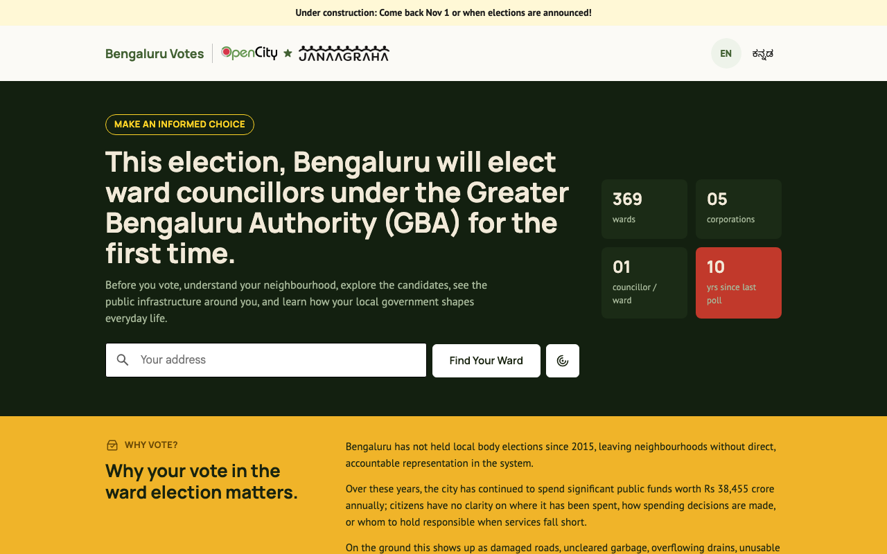
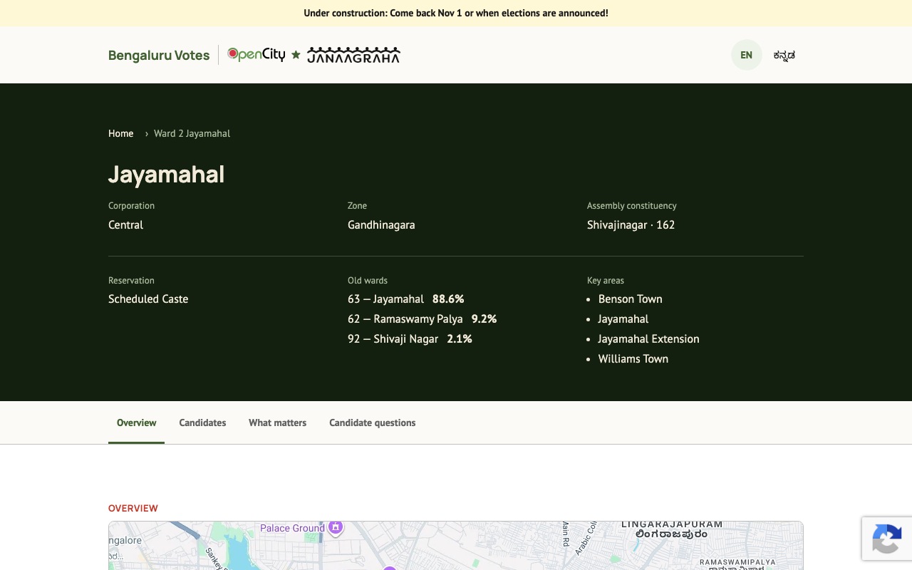
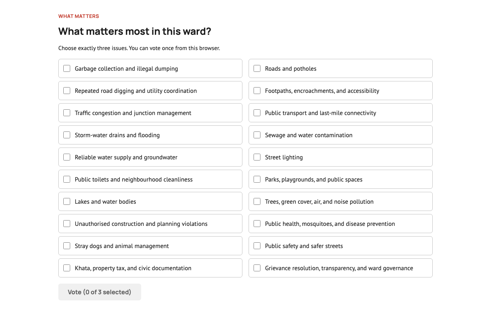
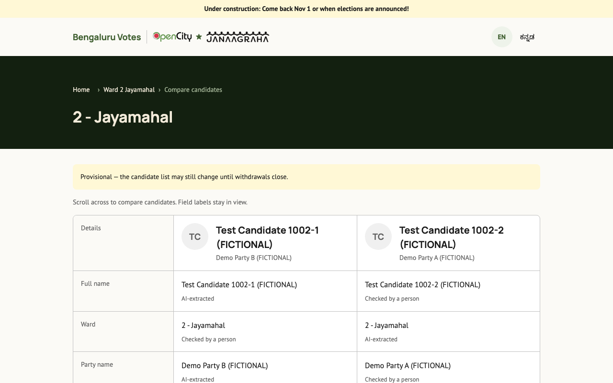
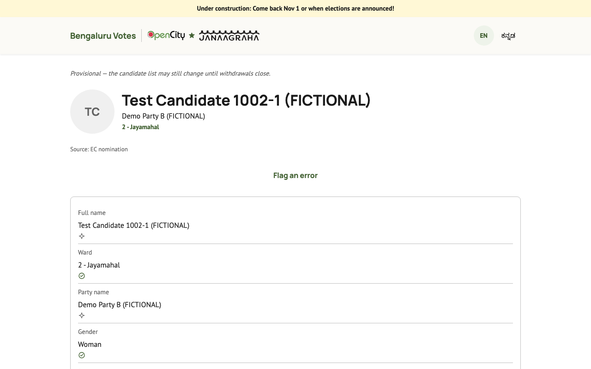
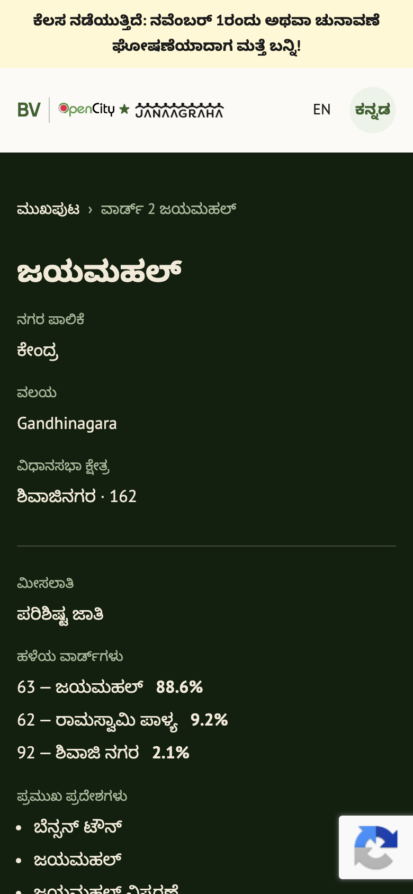

# Bengaluru Votes

**Ward-level information for Bengaluru's GBA (corporator) elections, in English and Kannada.**

Live at **[bengaluruvotes.opencity.in](https://bengaluruvotes.opencity.in)**, a project of [OpenCity](https://opencity.in) (Oorvani Foundation) with [Janaagraha](https://www.janaagraha.org).



## Why this exists

Bengaluru will elect ward councillors under the Greater Bengaluru Authority for the first time: 369 wards across five corporations, after a decade without a local body poll. Most residents don't know which new ward they live in, and trustworthy information about local candidates is hard to find. That is especially true for first-time voters, a large group this time, since almost nobody under thirty has ever voted for a corporator.

Bengaluru Votes puts neutral, sourced, ward-level election information in one place.

## What citizens can do

- **Find their new ward**, from a typed address or the device's location.
- **Find their polling booth**, from their voter ID (EPIC) number.
- **See what matters in the ward**, and vote on the top three local issues.
- **Read candidate report cards and compare candidates side by side.** Every value says whether it was AI-extracted or checked by a person, and links back to its source.
- **Follow the voting logistics** as a checklist: check registration, get or update a voter ID, learn how to vote.
- **See their ward's result** once it is declared.
- Do all of it in **English or ಕನ್ನಡ**.

## Screenshots

| Ward page | What matters in the ward |
|---|---|
|  |  |
| **Compare candidates** | **Candidate report card** |
|  |  |

<p align="center">
  <br>
  <em>Every page has a Kannada version, and the site works on phones.</em>
</p>

> The candidates shown above are demo data, clearly labelled `(FICTIONAL)`. This site serves a real election, so the project never uses plausible-looking fake candidates or parties.

## Behind the scenes

A small trusted team keeps the data accurate:

- **Transcribers** check the AI-extracted fields from candidate affidavits, one candidate at a time.
- **Curators** work through errors that citizens flag, and fix the data or reject the flag.
- **Admins** manage users, roles and access.

## Tech stack

- **[Astro](https://astro.build)** SSR monolith in TypeScript (Node adapter). Public pages ship with zero client JavaScript by default and use small islands for maps and lookups.
- **Postgres** through **Drizzle** with forward-only SQL migrations.
- **nginx** for TLS, rate limiting and a micro-cache in front of anonymous pages.
- **Background containers**: a cron `jobs` container and an affidavit extraction worker.
- **Claude** (Anthropic API) for affidavit field extraction and Kannada translation, the **Google Maps Platform** for geocoding, ward maps and address autocomplete, and **Twilio/SendGrid** for messaging.
- Runs as one Docker Compose stack on a single VPS in Mumbai.

The full design is in [`docs/architecture.md`](docs/architecture.md).

## Getting started

You need Node ≥ 22 and Docker.

```sh
docker compose -f deploy/compose.local.yml up --build -d   # http://localhost:4321
```

That builds from your working tree and runs migrations. Seeding, the test setup (Vitest and Playwright each need their own database), the full command list and the codebase conventions are all in **[`AGENTS.md`](AGENTS.md)**. It is the working guide for anyone, human or agent, changing this code.

## Project layout

```
src/        Astro app: pages (EN at root, Kannada under /kn/), islands, lib, db schema
jobs/       cron jobs and the affidavit extraction worker
scripts/    seeds, translation, data updates, extraction evals
data/       ward boundaries (GeoJSON), ward facts, city issues
drizzle/    SQL migrations
deploy/     Compose files, nginx config, deploy script, runbook
docs/       product, architecture and operations docs
tests/      unit, route, e2e and load tests
```

## Documentation

| Read | For |
|---|---|
| [`docs/overview.md`](docs/overview.md) | What the platform does and for whom |
| [`docs/milestones.md`](docs/milestones.md) | The plan of work |
| [`docs/architecture.md`](docs/architecture.md) | The technical design |
| [`docs/design-system.md`](docs/design-system.md) | Visual language and components |
| [`docs/election-timelines.md`](docs/election-timelines.md) | What the election calendar allows |
| [`deploy/runbook.md`](deploy/runbook.md) | Provisioning, deploys, environment variables, operations |
| [`AGENTS.md`](AGENTS.md) | Commands, tests and conventions for working on the code |

## Support the project

Bengaluru Votes is free, ad-free and non-partisan. It is run by the [Oorvani Foundation](https://oorvani.org), the non-profit behind OpenCity. If it helped you or your neighbours vote informed, please consider **[supporting Oorvani](https://oorvani.org/support-us)**.

## License

[MIT](LICENSE) © 2026 Siva Narayanan
